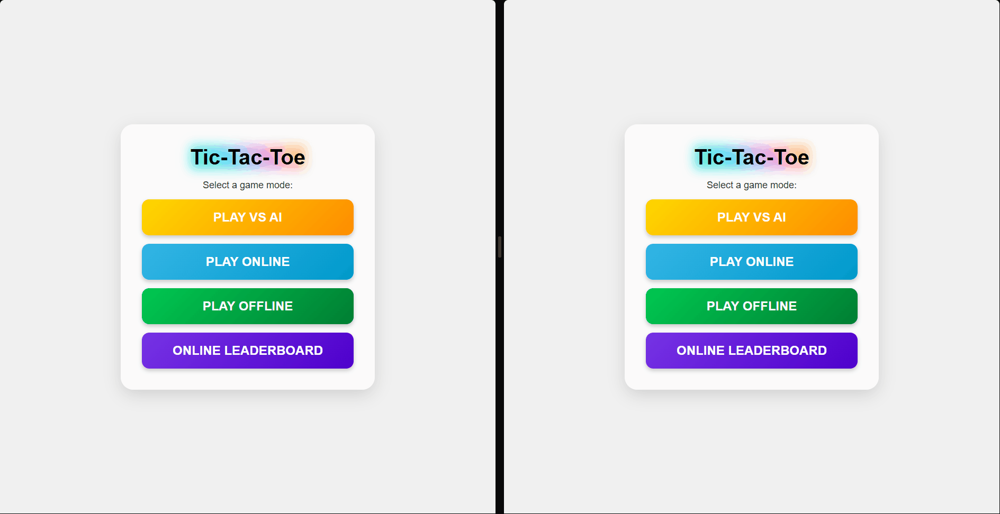
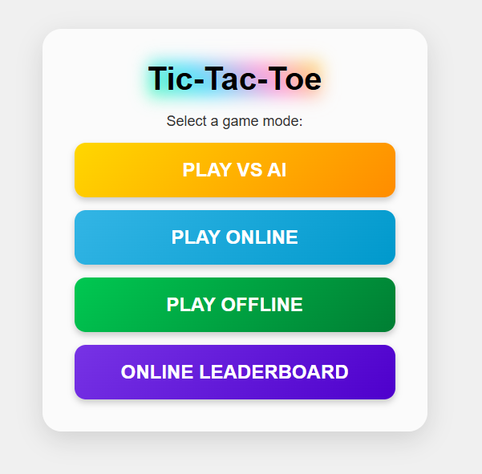
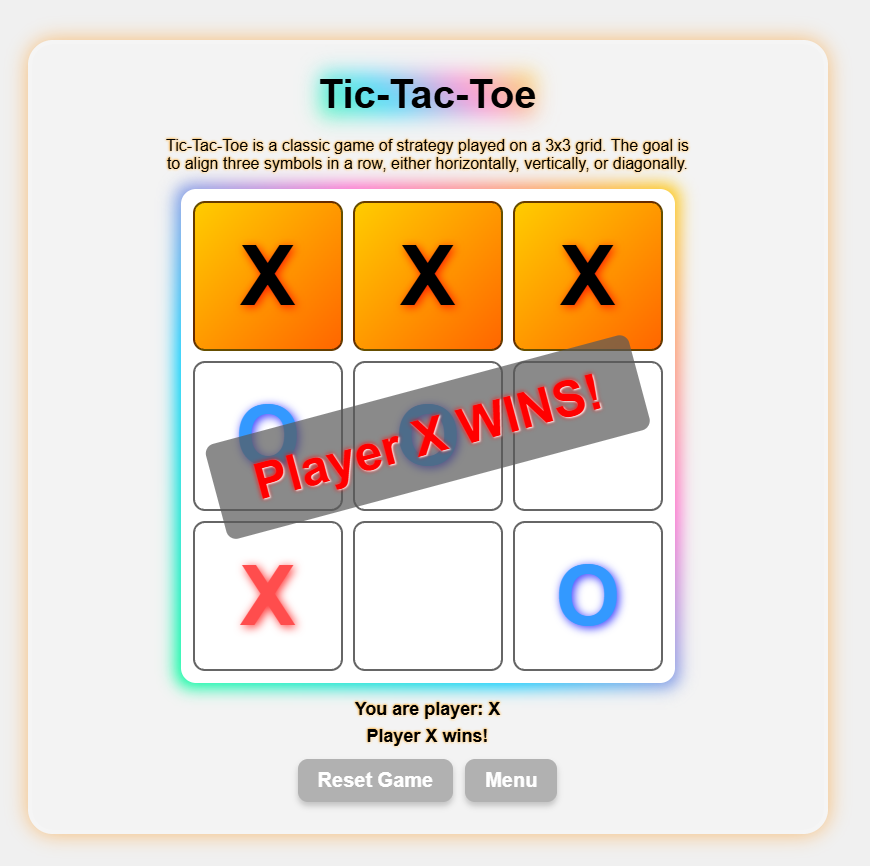
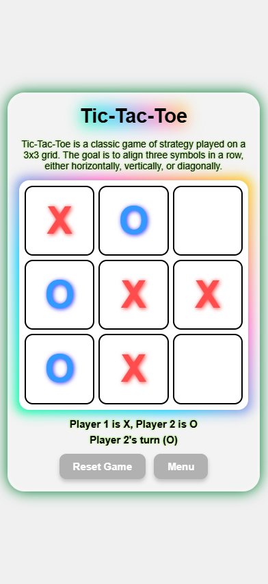
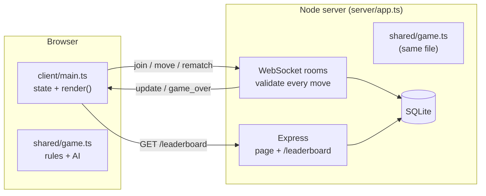

# Tic-Tac-Toe

[](https://github.com/daniel-omari/TicTacToe/actions/workflows/ci.yml)

A web-based Tic-Tac-Toe game with three ways to play: local two-player, against an AI
with four difficulty levels (one of them provably unbeatable), and real-time online play
against another person, through quick match or a private room code. It is written in
TypeScript with no frameworks: a plain HTML and CSS page in the browser, and a small Node
server that runs the online matches over WebSockets and keeps a leaderboard in SQLite.
Built as a personal project to dig into game AI and real-time multiplayer.

**Play it live: [tictactoe-n3eh.onrender.com](https://tictactoe-n3eh.onrender.com)**
(free hosting, so the first visit after a quiet spell takes about a minute to wake the
server up). For online play, open it on two devices, or send a friend a private room code.



| Main menu | Versus the AI | On a phone |
| :---: | :---: | :---: |
|  |  |  |

## Game modes

- **Offline:** two players share one screen, keyboard or mouse.
- **Versus AI:** play the computer at one of four levels: Naive, Intermediate, Advanced
  or Unbeatable. Players swap symbols after every finished game (X always moves first),
  so you take turns opening.
- **Online:** Quick Match pairs you with the next person looking for a game, or create a
  Private Room and send the 5-character code to a friend. When a game ends, both players
  can vote for a Rematch, which swaps symbols.
- **Leaderboard:** the top 10 online players by wins, losses and draws. Every browser
  gets a generated name like "Swift Falcon 12", so there are no accounts to make and no
  typed-in names to moderate.

## The AI

The levels differ in what the AI notices, not just in how often it slips:

- **Naive** plays the best move about 60% of the time and a random move otherwise, so it
  can miss wins and blocks.
- **Intermediate** always takes a win and blocks about 80% of the time; otherwise it takes
  the centre or a corner with no lookahead, so it walks into forks.
- **Advanced** plays like a strong human: it never misses a win or a block, and plays the
  perfect move about 70% of the time. Otherwise it overlooks something deeper, like a fork
  two moves away, so it can be beaten from either side.
- **Unbeatable** runs a full minimax search with alpha-beta pruning on every move. The
  best anyone can manage against it is a draw.

At every level, ties between equally good moves are broken at random, so games don't
repeat.

How often a player beats each level. These are exact figures, not samples: a script walks
every possible game, weighting each AI move by the probability that level plays it.

| Level | Perfect player as X | Perfect player as O | Casual player as X | Casual player as O |
| --- | ---: | ---: | ---: | ---: |
| Naive | 70% | 54% | 50% | 33% |
| Intermediate | 100% | 29% | 46% | 15% |
| Advanced | 34% | 12% | 9% | 4% |
| Unbeatable | 0% | 0% | 0% | 0% |

A "perfect player" picks whatever maximises their chance of winning; a "casual player"
always takes a win or blocks one, and otherwise plays a random move. Playing O is harder
at every level, because X moves first.

Minimax scores each finished position (a win for the AI, a win for the player, or a draw)
and backs those scores up the game tree, picking the move that maximises its worst-case
outcome. Faster wins score higher, so it finishes games quickly, and alpha-beta pruning
skips branches that cannot change the choice.

## Architecture



- **One set of rules.** `src/shared/game.ts` is pure logic (no page or network code). The
  browser, the server and the tests all import the same module, so the rules exist in
  exactly one place.
- **One typed protocol.** Every WebSocket message is a type in `src/shared/protocol.ts`,
  written as a union both sides import. The client's message handler switches on `type`,
  and TypeScript narrows each case to that message's fields, so a misspelled message or a
  missing field fails the build instead of failing silently in the browser. Messages
  arriving at the server are still untrusted, so it checks every field at runtime too.
- **One state object, one `render()`.** The client keeps everything the screen shows in a
  single `state` object; event handlers change it and call `render()`, which draws the
  board, status and buttons the same way in every mode.
- **The server owns online games.** The client only sends requests. The server checks
  every move (right turn, legal cell, and the sender's own server-assigned symbol and
  room, so a tampered client cannot move for its opponent), detects wins and draws itself,
  and the board on screen changes only when its update arrives.

## Online multiplayer

- **Rooms:** Quick Match fills public rooms in order of arrival. A private room gets a
  random 5-character code (from `crypto.randomInt`, skipping look-alike characters such as
  0/O and 1/I/L) that quick match never uses. Each connection can be in one room at a time.
- **Leaving and rematches:** if a player leaves, the other gets a fresh board and waits
  for a new opponent, and a private room stays open under the same code. A rematch starts
  once both players ask, with symbols swapped.
- **Robustness:** malformed or oversized messages (over 1 KB) are refused without
  affecting anyone else. The server pings every player every 30 seconds, which keeps
  connections open through the host's proxy and frees the seat of anyone whose connection
  silently dropped.
- **Players and the leaderboard:** each browser keeps a random secret ID in local storage
  and sends it when joining. The server turns the ID into a public name (adjective, animal
  and number, so nobody types a name in) and records each finished game against both
  players in SQLite, whatever symbol they had. IDs are never sent back out; `/leaderboard`
  returns only names and records. Games against a guest, or between two tabs of the same
  browser, aren't ranked.

## Accessibility

- The board is keyboard playable: arrow keys move between cells (stopping at the edges)
  and Enter or Space places a mark.
- ARIA roles and labels describe the grid and every cell ("Cell 5, X, winning line"), and
  a live region announces whose turn it is and who won.
- Focus moves into each screen as it opens, and a visible focus outline is kept for
  keyboard users.
- With the operating system's "reduce motion" setting, symbols fade in instead of popping
  and the winning line stops pulsing.
- The layout is fluid (`clamp()` / `min()`), so the board fits anything from a phone to a
  desktop, and touch screens get their own tap handling.

## Tech stack

- TypeScript in strict mode, compiled with `tsc` to native ES modules (no bundler): the
  browser loads the compiled client directly, and Node runs the compiled server.
- Plain HTML and CSS on the frontend, no frameworks.
- Node.js with Express (page + HTTP API) and `ws` (WebSockets).
- SQLite through Node's built-in `node:sqlite` module (no native add-on to compile).
- `node:test` for unit and integration tests, ESLint with `typescript-eslint`, and GitHub
  Actions CI.
- Docker (a build stage compiles, the runtime stage ships only the output), deployed on
  Render.

## Project structure

```
public/          the page: index.html and styles.css
src/shared/      game.ts (rules, AI, player names) and protocol.ts (message types),
                 used by both the browser and the server
src/client/      main.ts: the browser client (state, rendering, input, WebSocket client)
src/server/      app.ts (WebSocket and HTTP server, rooms, leaderboard) and main.ts
                 (starts it)
test/            unit tests for the rules and AI, integration tests against the server
dist/            the compiled output (made by npm run build, not committed)
Dockerfile       the production image used for the live demo
```

## Running

Start the server (needs Node.js 22.13 or newer):

```bash
npm install     # express and ws, plus TypeScript and ESLint for development
npm start       # compiles, then serves the game on http://localhost:3000 (PORT changes it)
```

Then open http://localhost:3000 in two browser tabs or on two machines and choose Play
Online. The server hosts the page itself and the browser connects back to the same address,
so the same build works locally and when deployed. It creates `tic_tac_toe.db` on first run.

## Deploying

The `Dockerfile` builds one small image that serves everything:

```bash
docker build -t tic-tac-toe .
docker run -p 3000:3000 tic-tac-toe     # then open http://localhost:3000
```

The live demo runs this image as a free web service on Render, which builds it straight
from this repository and sets `PORT` itself. The browser connects back to whatever address
served the page, over `wss://` on HTTPS, so no URLs need changing.

## Testing

```bash
npm test        # compiles, then runs 40 tests: rules and AI, plus server integration tests
npm run lint    # ESLint
npm run build   # just compile (and type-check)
```

Highlights:

- **Unbeatable is proven never to lose.** Tic-Tac-Toe is small enough to check
  exhaustively, so a test plays out every possible game against it, as X and as O,
  including every tie it might pick at random, and fails if it ever loses.
- **Advanced never misses a win or a block,** checked in every reachable position.
- **The server is tested as a black box:** a real instance on a random port, with real
  WebSocket clients, checks rooms and quick match, rejection of illegal and tampered moves,
  malformed and oversized messages, rematches, players leaving or silently disconnecting,
  that records follow players across symbol swaps without ever exposing their IDs, and
  that only the game's own files are served.

GitHub Actions runs linting, the type-check and build, the tests and `npm audit` on Node 22
and 24 for every push.

## Notes

This is a hobby project. Without accounts, a player's identity is just their browser, so
clearing site data (or switching browsers) starts a new name and record. The live demo runs
on a free plan: it sleeps after 15 minutes without visitors (the first visit after that
takes about a minute to wake it), and it has no persistent disk, so its leaderboard starts
from zero whenever it restarts.
